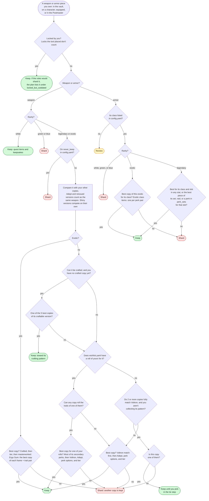
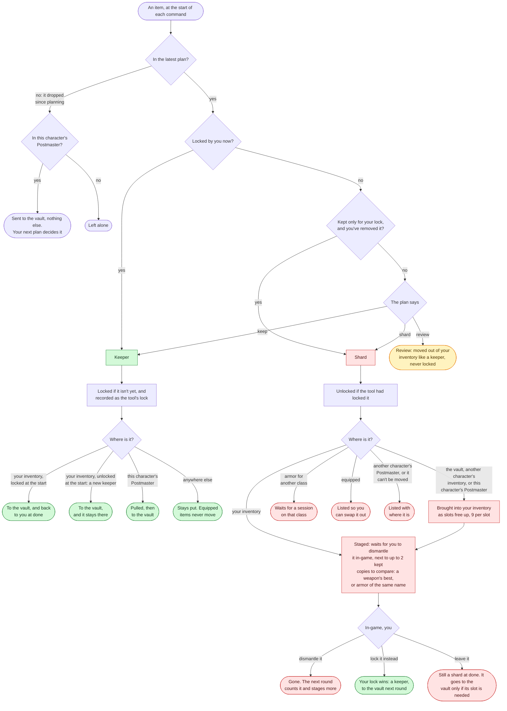
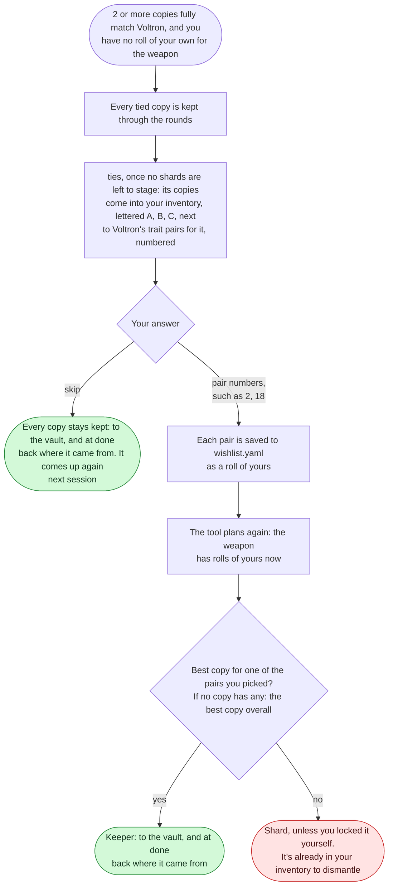

# destiny_post_session_sweeper_bot

At the end of a Destiny 2 session, decides which weapons and armor to keep or
shard, locks the keepers, and stages the shards on your character so you can
dismantle them quickly in-game. Dismantling stays manual: Bungie's API has no
dismantle endpoint.

The rules are in [How each item is decided](#how-each-item-is-decided), and
what each command does with them is in
[What `apply`, `next`, and `done` do with it](#what-apply-next-and-done-do-with-it).

## Setup

1. Install dependencies: `uv sync`
2. Copy `.env.example` to `.env` and follow the Bungie app steps in it.
3. Sign in once: `uv run sweeper login`
4. Download the game data: `uv run sweeper update-data`. This fetches Bungie's
   manifest (about 200 MB, kept trimmed to about 15 MB) and the Voltron
   wishlist (about 30 MB). If you skip it, the first `plan` does it, and the
   first command after each game patch downloads the new manifest.

## Talk to Claude instead

[`skill/SKILL.md`](skill/SKILL.md) is a Claude Code skill that runs the
commands below for you, so a session is a conversation: "I'm done playing",
"go", "done dismantling", "keep pairs 2 and 18", "put my stuff back". It asks
before anything that changes your account. To use it, copy or link the
`skill/` folder to `.claude/skills/sweeper/` in this repo, or to
`~/.claude/skills/sweeper/` to have it everywhere.

## Commands

| Command | Does |
|---|---|
| `uv run sweeper login` | Sign in to Bungie in your browser (again only after 90+ unused days) |
| `uv run sweeper fetch` | Save a read-only inventory snapshot to `data/profiles/` |
| `uv run sweeper plan` | Dry run: decide keep/shard for armor and weapons and write `data/runs/<time>-plan.yaml` |
| `uv run sweeper plan --profile <file>` | What-if: plan from a saved snapshot (a file name in `data/profiles/`, or a path) into `data/runs/what-if/`, which `apply` never uses |
| `uv run sweeper apply` | Start the session: lock keepers, move them out of your inventory, stage round 1 of shards |
| `uv run sweeper next` | After you dismantle in-game: stage the next round |
| `uv run sweeper ties` | Tie step: bring one tied weapon's copies in, list its trait pairs, and save your pick |
| `uv run sweeper ties --pick 2,18` / `--skip` | Answer the tie step without the prompt (for the skill) |
| `uv run sweeper done` | Put your gear back and end the session |
| `uv run sweeper update-data` | Refresh the Bungie manifest and Voltron wishlist caches now (`--force` downloads the manifest again and accepts a much smaller Voltron) |

`apply`, `next`, `ties`, and `done` change your account, but only by locking,
unlocking, and moving items: nothing is ever deleted, and dismantling stays
in-game (Bungie's API can't dismantle). Each takes `--dry-run` to show what it would do
without sending anything to Bungie. Preferences live in `config.yaml` and your
own weapon rolls in `wishlist.yaml`. The DIM fallback (`dim`) is not built yet.

Only one command runs at a time. Everything the tool writes is private to you,
and `data/` keeps the newest 5 profile snapshots and 25 plans.

In a terminal the output is in color (set `NO_COLOR=1` for plain text) and
wrapped to fit, and while a command works, its last line names the step it's
on and counts the items as they go, such as `Locking keepers: 120 of 689`.

### End of a session

1. `plan`, and read the summary. It also names any in-game loadout that uses a
   shard, and lists that loadout's gear and mods under `loadouts_affected` so
   you can rebuild it. `apply` only starts from a plan under 2 hours old.
2. `apply`. Before the first run, lock anything you're carrying that you want
   back afterwards: unlocked keepers are treated as new and stay in the vault.
   (Equipping only keeps a piece from moving; it can still be a shard.) Finish
   locking before you run it, and don't lock or unlock anything in-game while a
   command runs: a lock you add meanwhile could be taken for one of the tool's.
   The first run locks every keeper (a few minutes); later runs only touch new
   drops. Everything in the Postmaster goes to the vault first.
3. Dismantle everything staged in-game, then `next`. Repeat until it says no
   shards are left. Lock anything you decide to keep instead; it moves to the
   vault on the next round. Shards come with up to two of the copies being
   kept, locked, so you can compare them: a weapon's best copies, or armor of
   the exact same name. Those go back to the vault once the shards are gone.
4. `ties`, once per tied weapon: pick trait pairs by number (comma-separated)
   or press Enter to skip it this session. Picks are saved to `wishlist.yaml`
   with the date and game version. After a pick the tool plans again and stages
   the copies that no longer make the cut. The numbers stay the same until you
   answer. `ties --dry-run` only previews the list; answer after a real `ties`
   (and `ties --pick N --dry-run` previews what a pick would do).
5. `done` puts back what you were carrying and returns tie-step copies.

If a run stops partway (Bungie down, Ctrl-C), run the same command again: it
picks up where it stopped, including a tie-step pick that was saved but not
finished.

## How each item is decided

`plan` runs every weapon and armor piece through this flowchart. Green ends
are kept and red ends are shards. The full rankings behind each "best copy"
question are in [src/weapon_rules.py](src/weapon_rules.py) and
[src/armor_rules.py](src/armor_rules.py).

### What `apply`, `next`, and `done` do with it

Every command checks the live account against the latest plan first, so a
lock you add after planning still wins. The steps are in
[End of a session](#end-of-a-session).

### The tie step

A tied weapon's copies are all kept until you pick what you want from it.

## Data formats we depend on

A short map of the outside data this tool reads, as of September 2026, and
where each piece is used. When Bungie or Voltron changes a format, start here.
Hashes and plug category names live in `src/game_data.py`.

### Bungie API (`https://www.bungie.net/Platform`)

Every response is wrapped as `{Response, ErrorCode, ErrorStatus, Message,
ThrottleSeconds}`. `ErrorCode` 1 means success; anything else raises
`BungieApiError` (`src/bungie_api.py`).

| Call | Fields we read | Code |
|---|---|---|
| `POST /platform/app/oauth/token/` (Basic auth: client ID and secret) | `access_token`, `expires_in`, `refresh_token`, `refresh_expires_in`, `membership_id` | `src/oauth.py` |
| `GET /User/GetMembershipsForCurrentUser/` | `destinyMemberships[]` (`membershipType`, `membershipId`, `bungieGlobalDisplayName`, `bungieGlobalDisplayNameCode`), `primaryMembershipId` | `src/bungie_api.py` |
| `GET /Destiny2/{type}/Profile/{id}/?components=100,102,200,201,205,206,300,305,310` (`plan`, `ties`, `fetch`) | see below | `src/inventory.py`, `src/weapons.py`, `src/loadouts.py` |
| `GET /Destiny2/{type}/Profile/{id}/?components=102,200,201,205` (`apply`, `next`, `done`) | where everything is | `src/account.py` |
| `GET /Destiny2/Manifest/` (no key needed) | `version` (checked against `[\w.-]+`; also saved on tie-step wishlist rolls as `game_version`), `jsonWorldComponentContentPaths.en[<table>]` (must be on www.bungie.net) | `src/manifest.py` |
| `POST /Destiny2/Actions/Items/SetLockState/` | body `{state, itemId, characterId, membershipType}` | `src/bungie_api.py` |
| `POST /Destiny2/Actions/Items/TransferItem/` | body `{itemReferenceHash, stackSize, transferToVault, itemId, characterId, membershipType}` | `src/bungie_api.py` |
| `POST /Destiny2/Actions/Items/PullFromPostmaster/` | body `{itemReferenceHash, stackSize, itemId, characterId, membershipType}` | `src/bungie_api.py` |

The three item actions need the "Move or equip Destiny gear" scope. Bungie
documents `ThrottleSecondsBetweenActionPerUser: 0.1` for each, so they are
sent at most every 0.1 seconds, counted from when each is sent. Instance and
character IDs are sent as strings.
`characterId` is the character holding the item; for a vault item it is any of
your characters (the current one), and for a move out of the vault it is the
destination. Moving between characters is two transfers through the vault.
Error statuses the tool reacts to:

- Retried after 1, 2, 4, 8, 16 seconds: `DestinyThrottledByGameServer` and the
  `ThrottleLimitExceeded*` / `Per*ThrottleExceeded` family.
- Skipped for that item, and the run carries on: `DestinyItemNotFound`,
  `DestinyNoRoomInDestination`, `DestinyItemNotTransferrable`,
  `DestinyItemNotTransferrableHasSideEffects`,
  `DestinyCannotPerformActionOnEquippedItem`, `DestinyItemActionForbidden`.
- Anything else stops the run; running the command again continues it.

From the profile:
- `profile.data.userInfo`: account display name.
- `characters.data[<characterId>]`: `classType` (0 Titan, 1 Hunter, 2 Warlock),
  `dateLastPlayed`, `light`.
- `profileInventory.data.items[]`,
  `characterInventories.data[<characterId>].items[]`,
  `characterEquipment.data[<characterId>].items[]`: `itemHash`,
  `itemInstanceId`, `bucketHash` (vault 138197802, Postmaster 215593132),
  `state` bit flags (1 locked, 4 masterworked, 8 crafted; enhanced weapons have
  it too, and a named plug such as "Enhancement 1" in the
  `crafting.plugs.weapons.mods.enhancers` category tells them apart),
  `lockable`, and `transferStatus` bit flags (1 equipped, 2 not movable).
  Postmaster items report 2 and `lockable` false until pulled, so there the
  definition's `nonTransferrable` decides.
- A profile missing any of `profileInventory`, `characters`, or a character's
  `characterInventories` or `characterEquipment` is refused.
- `characterLoadouts.data[<characterId>].loadouts[]`: `nameHash` and
  `items[]` (`itemInstanceId`, `plugItemHashes[]` in socket order). Unused
  slots have `nameHash` 2166136261 and item ID `0`.
- `itemComponents.instances.data[<instanceId>].gearTier`: 0 for pre-Edge of Fate
  gear, otherwise 1-5.
- `itemComponents.sockets.data[<instanceId>].sockets[]`: `plugHash` per socket.
- `itemComponents.reusablePlugs.data[<instanceId>].plugs[<socketIndex>][]`:
  `plugItemHash` for every option in a weapon perk column, masterwork, or
  tuning socket.
- The masterwork socket holds a plug in a `*.plugs.weapons.masterworks*`
  category (not the `.trackers` one) named like "Tier 3: Stability" or
  "Masterworked: Handling"; the stat is the part after the colon. A random
  roll is offered only higher tiers of its stat; a crafted or enhanced copy
  holds an unnamed plug and is offered every stat.

From the manifest tables:
- `DestinyInventoryItemDefinition`: `displayProperties.name`, `itemType` (2
  armor, 3 weapon), `itemTypeDisplayName`, `classType`,
  `inventory.bucketTypeHash` (slot), `inventory.tierType` (2 white, 3 green,
  4 blue, 5 legendary, 6 exotic), `isAdept`, `isHolofoil` (shiny),
  `nonTransferrable`, `equippingBlock.equipableItemSetHash`
  (armor set), `investmentStats[]` (`statTypeHash`, `value`,
  `isConditionallyActive`), `plug.plugCategoryIdentifier`,
  `sockets.socketCategories[]` (weapon perks are category 4241085061),
  `sockets.socketEntries[].randomizedPlugSetHash` / `reusablePlugSetHash`.
- `DestinyEquipableItemSetDefinition`: `displayProperties.name` (set name).
- `DestinyPlugSetDefinition`: `reusablePlugItems[].plugItemHash` (what a crafted
  weapon can be reshaped into).
- `DestinyInventoryBucketDefinition`: `itemCount` of the vault (1,300) and of
  each character bucket (10: 1 equipped + 9 carried).
- `DestinyLoadoutNameDefinition`: `name` (Solar, PvE, ...) of each loadout.
- Each table is cached per version in `.cache/manifest/<version>/`, trimmed to
  the fields above (other definitions keep only their name), with
  `complete.json` written once all are there. Offline, only a complete version
  is used.
- Mod plug categories listed for loadouts: `enhancements.*` (armor, artifice,
  raid, and stat mods), the armor tuning category, and `v400.weapon.mod_*`.
- Plug categories the armor rules key on: `armor_stats` and `intrinsics` (base
  stats), `armor_archetypes`, and
  `core.gear_systems.armor_tiering.plugs.tuning.mods` (the tuning socket).

### Voltron (`voltron.txt`)

A plain-text DIM wishlist from
`github.com/48klocs/dim-wish-list-sources`, cached daily in `.cache/voltron.txt`
and parsed by `src/voltron.py`. Line types:

| Line | Meaning |
|---|---|
| `title:<text>` | Start of a source section, e.g. `PvE Podcast 174 - The Best Machine Guns` |
| blank line | Ends the current block |
| `// <weapon> - <roll label>` | Block heading, e.g. `// Fatebringer - PvE Minors god 1` |
| `//notes:<text>` | Notes for the entries below it, until the next blank line |
| `dimwishlist:item=<itemHash>&perks=<perkHash>,...[#notes:<text>]` | One acceptable perk combination for one weapon version |

- There is no ranking. Each curator's roll is expanded into every acceptable
  barrel × magazine × trait combination, so one weapon can have hundreds of
  lines (Fatebringer: 1,875 lines, 323 distinct PvE combinations).
- PvE or PvP comes from tags in the notes (`|tags:pve,mkb`, `(PvE-God M+KB)`),
  else the block heading, else the section title. Unmarked entries count for
  both.
- Negative item hashes (trash rolls) and the `-69420` wildcard are skipped;
  Voltron has none today.
- Each perk's role comes from its hash's `plugCategoryIdentifier` (`frames` for
  traits, `origins`, `barrels`, `magazines`, ...), not its name: names repeat
  across categories ("Demolitionist" is an armor archetype and a weapon trait).
  The tie step groups entries by their trait pair.
- Sanity checks: a download with under half the previous copy's lines is
  refused (the old copy stays), and if over 5% of lines name hashes the
  manifest doesn't know (normally 0.05%), planning stops. The parsed rolls are
  cached in `.cache/voltron-parsed.json` until the file, manifest, or modes
  change.

### If something breaks

| Symptom | Likely change | Look at |
|---|---|---|
| `Error: ... failed: <ErrorStatus>` | An endpoint moved or changed | `src/bungie_api.py` |
| Sign-in fails with `invalid_grant` or no refresh token | App settings or the OAuth flow changed | `.env`, `src/oauth.py` |
| Armor shows 0 stats, or no archetypes or tuned stats | A plug category was renamed | `src/game_data.py`, `src/inventory.py` |
| Weapons have no perk columns | The weapon-perks socket category changed | `src/game_data.py`, `src/weapons.py` |
| Nothing matches Voltron | The line format or its hashes changed | `src/voltron.py` |
| `Warning: The new Voltron wishlist has N rolls, under half...` | Voltron's file shrank or broke; the old copy is in use | Voltron's repo; `update-data --force` if the drop is real |
| `Error: ... Voltron rolls name weapons or perks this manifest doesn't know` | Bungie or Voltron changed hashes | `update-data`, then wait a day |
| `Error: Bungie sent an incomplete profile` | A Bungie hiccup | Run the command again in a minute |
| `Error: data/state.json is damaged` | The state file was cut short or edited | Restore it, or move it aside (every lock then counts as yours) |
| The tie step shows no trait pairs | Trait plug categories (`frames`, `origins`) were renamed | `src/game_data.py`, `src/voltron.py` |
| `apply` stops with an unfamiliar error status | A new item-level error should be skipped, not stop the run | `ITEM_ERROR_REASONS` in `src/account.py` |
| Slots, classes, or locations look wrong | A bucket hash or item state flag changed | `src/game_data.py` |
| An enhanced weapon shows as crafted in the plan | The enhancement plug category changed | `ENHANCER_PLUG_CATEGORY` in `src/game_data.py` |
| No copy has your roll's masterwork, or the plan shows none | Masterwork plug names or categories changed | `MASTERWORK_PLUG_CATEGORY_FRAGMENT` in `src/game_data.py`, `masterwork_stat` in `src/definitions.py` |

## Development

- Lint and format: `uv run ruff check .` and `uv run ruff format .` (88-character
  lines are enforced). The pre-commit hooks run the same pinned ruff.
- Tests: `uv run python -m pytest`. They never touch `data/` or `.cache/`
  (`tests/conftest.py`).

## License

CC0 1.0 Universal - See [LICENSE](LICENSE) for details.
